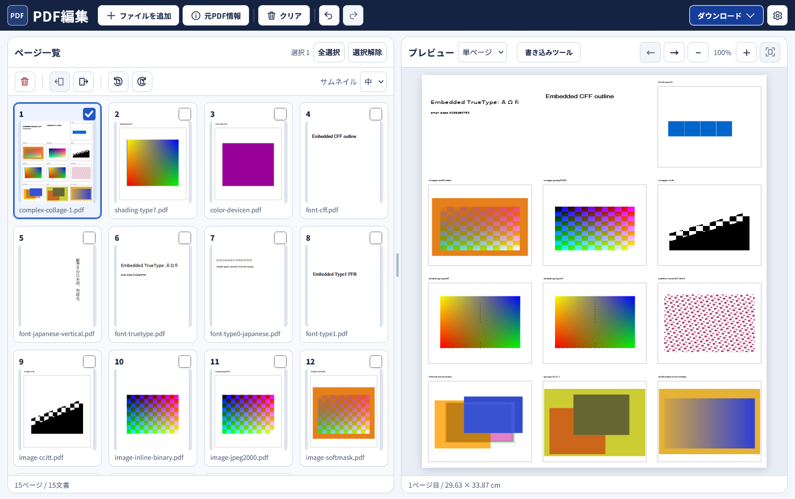

# pdf-editor

アプリのバージョンは右上の設定メニューで確認できます。



ブラウザーでPDFのページを並べ替え・回転・削除し、注釈を追加するツールです。PDF・JPEG・PNGを読み込めます。ファイルの処理はブラウザー内で行います。

## 使い方

配布ファイルの `pdf-editor.html` をブラウザーで開きます。単一HTMLなので、オフラインでも使えます。静的サイトとして置く場合は、`dist/pdf-editor.html` または `src/` フォルダーの中身一式を公開してください。

左のページ一覧にファイルをドロップするとページを追加します。書き込みツールを開き、右の用紙にPNG・JPEGを1枚ドロップすると、画像スタンプを配置します。スタンプは画像のDPI（未指定なら96 DPI）から求めた寸法で配置し、用紙より大きい場合は収まる寸法に縮めます。

ダウンロード形式はPDF、JPEG、PNGから選べます。JPEGとPNGは指定した解像度でページを白背景に描画し、ページ別の画像をZIPにまとめます。JPEGは画質を0〜100%で指定でき、PNGは描画した画素を可逆圧縮で保存します。

PDFを結合する場合、文書全体の出力ICCは、出力の先頭ページの元PDFから引き継ぎます。保存時にスクリプトや外部動作は除き、読み上げ用のタグは引き継ぎません。同名フォーム欄の衝突は通知しますが、フォームの定義は修正しません。

## 開発・配布

Node.js 24とnpmを使います。版番号の参照元は `package.json` の `version` です。更新時は `npm version <新しい版番号> --no-git-tag-version` でロックファイルも同期し、`npm run package` で設定メニューの表示と配布ファイルを更新します。

```sh
npm ci
npm run build
npm test
```

- `src/`：静的公開できるアプリのソース
- `dist/pdf-editor.html`：ビルドで生成する単一HTML
- `npm test`：ビルド結果の照合、操作ロジック、PDF構造、代表PDFの保存前後の描画を検査
- `npm run package`：`build-output/` に `pdf-editor-source.zip` と `pdf-editor.html` を作成

実ブラウザーでの検査は `npx playwright install chromium` の後に `npm run test:browser` を実行します。テストはPDF.jsでの保存前後を比較します。別の描画エンジンや印刷機器での一致を保証する検査ではありません。

Dockerを使う場合は `docker build -t pdf-editor .`、`docker run --rm pdf-editor` でNodeのテストを実行できます。アプリを使うためのコンテナは不要です。

同梱ライブラリとフォントのライセンスは [src/vendor/LICENSES.txt](src/vendor/LICENSES.txt) と [tests/fixtures/licenses/](tests/fixtures/licenses/) を参照してください。
